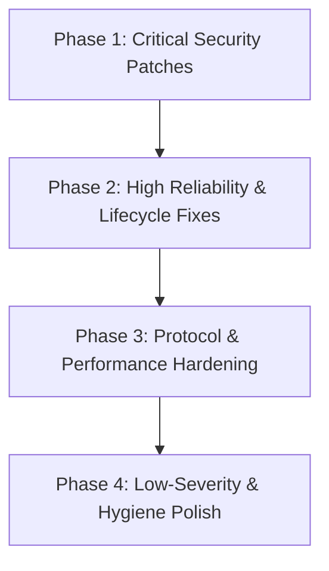

# Comprehensive Codebase Audit & Systems Analysis Report

**Target Project:** `dev-web-stack` (local development platform)
**Root Path:** `/data/wwwroot/development/python/dev-web-stack`
**Git Branch / Commit:** `plan-4-release` (`bfb1593`)
**Audit Scope:** End-to-end audit across Proxy & FastCGI, Privileged Helper & Security Boundaries, Site Management & Vhosts (Apache/Nginx), PHP-FPM & INI Engine, Process Supervisor & Daemon Lifecycle, REST API & SQLite Store, UI (Svelte 5 / TypeScript), Build Scripts, Installer, and Test Suites.
**Policy Notice:** In accordance with instructions, all findings are cataloged in detail; no source code or configuration files have been modified.

---

## Executive Summary

An exhaustive, multi-agent code review and security audit was conducted on the entire `dev-web-stack` codebase. The architecture demonstrates significant engineering rigor in multiple areas:
- Immutable routing snapshots in the reverse proxy.
- Kernel-enforced `SO_PEERCRED` UID authentication over local Unix domain sockets.
- Userspace TCP port forwarding avoiding netfilter/iptables pollution.
- Deterministic archive extraction with path traversal guards (`mkdirAllNoSymlink`, `resolveLinkTarget`).
- Pinned `SOURCE_DATE_EPOCH` reproducible release builds.

However, the audit revealed **5 Critical**, **18 High**, **26 Medium**, and **19 Low/Operational** bugs, architectural flaws, and security vulnerabilities. These range from arbitrary filesystem exposure and local privilege escalation vectors to protocol non-compliance, process deadlocks, and silent failure modes.

### Findings Summary Matrix

| Severity | Count | Primary Impact Areas |
|---|---|---|
| **Critical** | **5** | Arbitrary host filesystem disclosure, unauthenticated directory browsing, Apache 403 route breakage, classic HTTPOXY proxy hijacking, silent certificate renewal desynchronization. |
| **High** | **18** | Privileged helper arbitrary host file exposure, root symlink takeover of NSS trust databases, Nginx/Apache mode switch port conflicts, FastCGI early response clobbering (502s), HTTP server Slowloris leaks, supervisor deadlock, orphan process leaks, SQLite WAL pool starvation, CLI double-spawn race. |
| **Medium** | **26** | Non-atomic `/etc/hosts` truncation (`O_TRUNC`), FastCGI management record rejection, open redirect via protocol-relative URLs, RFC 3875 CGI status code divergence, unbuffered SSE streams, ephemeral socket exhaustion, TOCTOU port allocation races, secret redaction failures, Svelte 5 infinite polling loops, predictable temporary files (`$$`). |
| **Low / Notes** | **19** | PHP CLI 413 mapping, SNI domain fronting, TOCTOU symlink checks in PHP static serving, missing trailing slash redirects, process group escape on `setsid`, environment leakage in `RunAs`, Playwright test port collisions. |

---

## Table of Contents

1. [Critical Severity Vulnerabilities](#1-critical-severity-vulnerabilities)
2. [High Severity Issues](#2-high-severity-issues)
3. [Medium Severity Issues](#3-medium-severity-issues)
4. [Low Severity & Operational Notes](#4-low-severity--operational-notes)
5. [Subsystem Architectural Analysis](#5-subsystem-architectural-analysis)
6. [Prioritized Remediation Roadmap](#6-prioritized-remediation-roadmap)

---

## 1. Critical Severity Vulnerabilities

### [CRIT-01] Arbitrary Host Filesystem Exposure via DocumentRoot Validation Bypass
- **Files & Lines:**
  - [`internal/sites/service.go:1330-1349`](file:///data/wwwroot/development/python/dev-web-stack/internal/sites/service.go#L1330-L1349) (`validateDocumentRoot`)
  - [`internal/backend/local.go:623-660`](file:///data/wwwroot/development/python/dev-web-stack/internal/backend/local.go#L623-L660) (`resolveSiteDocumentRoot`)
  - [`internal/staticserve/handler.go:30-46`](file:///data/wwwroot/development/python/dev-web-stack/internal/staticserve/handler.go#L30-L46)
- **Mechanism:**
  In `validateDocumentRoot`:
  ```go
  target := root
  if !filepath.IsAbs(root) {
      if !filepath.IsLocal(root) {
          return "", fmt.Errorf("sites: document root %q escapes the project", root)
      }
      target = filepath.Join(projectRoot, root)
  }
  info, err := os.Stat(target)
  ```
  The containment check `filepath.IsLocal(root)` is evaluated **only** when `root` is a relative path. If a caller specifies an absolute path (e.g., `/etc`, `/var`, `/home/anotheruser/.ssh`), `!filepath.IsAbs(root)` evaluates to `false`. The function skips containment validation entirely and only checks whether `os.Stat(target)` exists and is a directory.

  Similarly, `resolveSiteDocumentRoot` in `internal/backend/local.go:637-638` directly accepts any absolute path:
  ```go
  case filepath.IsAbs(documentRoot):
      resolved = documentRoot
  ```
- **Real-World Impact:**
  In the default `builtin` serving mode, any user or API client can create or update a site with `document_root: "/etc"` or `"/home/user"`. The built-in static server / proxy will happily serve all host files from that directory over `https://<site>.test/passwd` or `https://<site>.test/id_rsa`.
- **Recommended Remediation Pattern:**
  Enforce that `target` is strictly contained within `projectRoot` regardless of whether `root` was passed as an absolute or relative path:
  ```go
  var target string
  if filepath.IsAbs(root) {
      target = filepath.Clean(root)
  } else {
      target = filepath.Join(projectRoot, root)
  }
  rel, err := filepath.Rel(projectRoot, target)
  if err != nil || rel == ".." || strings.HasPrefix(rel, ".."+string(filepath.Separator)) {
      return "", fmt.Errorf("sites: document root %q escapes project root %q", root, projectRoot)
  }
  ```

---

### [CRIT-02] Unauthenticated Arbitrary Filesystem Directory Enumeration via FS API
- **Files & Lines:**
  - [`internal/api/handlers_fs.go:60-73`](file:///data/wwwroot/development/python/dev-web-stack/internal/api/handlers_fs.go#L60-L73) (`handleFS`)
  - [`internal/api/middleware.go:125-136`](file:///data/wwwroot/development/python/dev-web-stack/internal/api/middleware.go#L125-L136) (`authenticate`)
- **Mechanism:**
  1. In `handlers_fs.go`:
     ```go
     if home := strings.TrimSpace(s.cfg.UserHome); home != "" {
         base, err := filepath.Abs(home)
         ...
         if !withinDirectory(base, resolved) {
             writeError(w, http.StatusForbidden, codeForbidden, "directory is outside the configured user home", nil)
             return
         }
     }
     ```
     If `s.cfg.UserHome` is empty (which happens if `os.UserHomeDir()` returns an error in headless, containerized, minimal service environments, or when `$HOME` is unset), the boundary check is skipped entirely.
  2. In `middleware.go`:
     ```go
     if !isMutation(r.Method) {
         next.ServeHTTP(w, r)
         return
     }
     ```
     `GET /api/v1/fs` is an unauthenticated read endpoint requiring neither a session cookie nor a CSRF token.
- **Real-World Impact:**
  Any local process or remote attacker able to issue HTTP GET requests to the loopback port can list all directories across the entire root filesystem (`/root`, `/etc`, `/var`, `/home/*`) without credentials. Even when `UserHome` is set, an unauthenticated client can map the complete directory hierarchy of the user's home folder.
- **Recommended Remediation Pattern:**
  1. Fail closed if `s.cfg.UserHome` is empty.
  2. Require authentication on `GET /api/v1/fs`:
  ```go
  if home := strings.TrimSpace(s.cfg.UserHome); home == "" {
      writeError(w, http.StatusInternalServerError, codeInternal, "user home is not configured", nil)
      return
  }
  ```

---

### [CRIT-03] Apache Front Controller PATH_INFO 403 Breakage via `security.limit_extensions`
- **Files & Lines:**
  - [`internal/vhost/apache.go:133, 146`](file:///data/wwwroot/development/python/dev-web-stack/internal/vhost/apache.go#L133-L146) (`writeApachePHPLocations`)
  - [`internal/phpfpm/render.go:49`](file:///data/wwwroot/development/python/dev-web-stack/internal/phpfpm/render.go#L49) (`RenderPoolConfig`)
- **Mechanism:**
  In `internal/vhost/apache.go:133`:
  ```apache
  RewriteCond %{REQUEST_FILENAME} !-f
  RewriteCond %{REQUEST_FILENAME} !-d
  RewriteRule ^(.*)$ /index.php/$1 [L,QSA]
  ```
  And in `internal/vhost/apache.go:146`:
  ```apache
  <FilesMatch "(?i)\.php$">
      SetHandler "proxy:fcgi://127.0.0.1:<port>"
  </FilesMatch>
  ```
  Meanwhile, `internal/phpfpm/render.go:49` configures PHP-FPM with:
  ```ini
  security.limit_extensions = .php
  ```
  When an incoming request with path info arrives (e.g. `/api/v1/users`), Apache rewrites the URI to `/index.php/api/v1/users`. Apache's `mod_proxy_fcgi` passes `SCRIPT_FILENAME` ending in `/users` (the path-info component) to PHP-FPM. PHP-FPM inspects the extension of `SCRIPT_FILENAME`. Because `/users` does not match `.php`, PHP-FPM's security guard triggers and immediately rejects the request with:
  `Access denied.` (HTTP 403 Forbidden).
- **Real-World Impact:**
  All modern PHP frameworks (Laravel, Symfony, WordPress, Slim) route incoming URLs through the front controller with `PATH_INFO`. In Apache external mode, every non-root framework route consistently fails with a 403 Forbidden error.
- **Recommended Remediation Pattern:**
  Rewrite the Apache rule to route directly to `/index.php` without appending `$1`:
  ```apache
  RewriteCond %{REQUEST_FILENAME} !-f
  RewriteCond %{REQUEST_FILENAME} !-d
  RewriteRule ^ /index.php [L,QSA]
  ```
  `mod_proxy_fcgi` will set `SCRIPT_FILENAME` to `<DocumentRoot>/index.php` and convey the original URI via `REQUEST_URI` and `PATH_INFO`.

---

### [CRIT-04] Classic HTTPOXY Vulnerability (CVE-2016-5385) via FastCGI `Proxy` Header
- **Files & Lines:**
  - [`internal/proxy/php.go:224-240`](file:///data/wwwroot/development/python/dev-web-stack/internal/proxy/php.go#L224-L240) (`phpCGIParams`)
- **Mechanism:**
  In `phpCGIParams()`, incoming HTTP headers are translated to CGI environment variables by prefixing `HTTP_` and uppercase-underscoring the name:
  ```go
  hopByHop := hopByHopHeaderSet(req.Header)
  for name, values := range req.Header {
      canonical := http.CanonicalHeaderKey(name)
      if canonical == "" || hopByHop[canonical] {
          continue
      }
      switch canonical {
      case "Content-Type", "Content-Length", "Host":
          continue
      }
      if strings.HasPrefix(strings.ToLower(canonical), "x-forwarded-") {
          continue
      }
      key := "HTTP_" + strings.ReplaceAll(strings.ToUpper(canonical), "-", "_")
      params[key] = strings.Join(values, ", ")
  }
  ```
  `hopByHopHeaders` lists standard connection headers (`Connection`, `Keep-Alive`, `Proxy-Authenticate`, `Proxy-Authorization`, `TE`, `Trailer`, `Transfer-Encoding`, `Upgrade`), but **omits `Proxy`**.
  When a client sends `Proxy: http://attacker.com:8080`, `phpCGIParams` generates:
  `params["HTTP_PROXY"] = "http://attacker.com:8080"`.
- **Real-World Impact:**
  In PHP environments, `$_SERVER['HTTP_PROXY']` and `getenv('HTTP_PROXY')` are trusted by default by numerous HTTP clients (Guzzle, cURL wrappers, Composer, PHP stream contexts). An attacker can hijack or intercept outgoing HTTP requests initiated by backend PHP applications (e.g. webhooks, API requests, OAuth token exchanges).
- **Recommended Remediation Pattern:**
  Explicitly filter out the `Proxy` header in `phpCGIParams` and add `"Proxy"` to `hopByHopHeaders`:
  ```go
  switch canonical {
  case "Content-Type", "Content-Length", "Host", "Proxy":
      continue
  }
  ```

---

### [CRIT-05] Silent Background Certificate Renewal Desync in External Vhosts
- **Files & Lines:**
  - [`internal/daemon/daemon.go:472-489`](file:///data/wwwroot/development/python/dev-web-stack/internal/daemon/daemon.go#L472-L489) (`renew`)
  - [`internal/sites/vhosts.go:88-125`](file:///data/wwwroot/development/python/dev-web-stack/internal/sites/vhosts.go#L88-L125) (`SyncVhosts`)
- **Mechanism:**
  In `daemon.renew`:
  ```go
  if d.sites.ServingMode() == config.ServingModeBuiltin {
      if err := d.sites.RebuildRoutes(ctx); err != nil { ... }
      return
  }
  if err := d.sites.SyncVhosts(ctx); err != nil {
      d.logger.Warn("daemon: sync vhosts after renewal", "error", err)
  }
  ```
  When certificates are renewed by `RenewDue`, new certificates are saved in the internal SQLite store and PKI cache. In external mode (Nginx/Apache), `SyncVhosts` must write them to disk and reload the web server.
  If `SyncVhosts` fails (e.g. due to temporary lock contention, vhost reload error, or helper unavailability), it only logs a `Warn` entry. No retry is scheduled, no failure state is recorded in `persistSettings`, and Doctor cannot detect that on-disk certs are stale compared to the database. External servers continue serving the old on-disk certificate until expiration.
- **Real-World Impact:**
  Sites running in external mode silently experience certificate expiration outages (`SEC_ERROR_EXPIRED_CERTIFICATE`), even though certificates were renewed inside devstack's database.
- **Recommended Remediation Pattern:**
  Record renewal sync failures in `daemon.reconcileErr` / `persistSettings`, alert in Doctor, and implement an exponential backoff retry ticker for failed renewals.

---

## 2. High Severity Issues

### [HIGH-01] Privileged Helper Allows Serving Arbitrary Host Files via Vhost Sync
- **Files & Lines:**
  - [`internal/helper/vhosts.go:943-966, 999-1036`](file:///data/wwwroot/development/python/dev-web-stack/internal/helper/vhosts.go#L943-L1036) (`validateBackendPath`, `validateContainedDocumentRoot`)
  - [`internal/vhost/apache.go:94`](file:///data/wwwroot/development/python/dev-web-stack/internal/vhost/apache.go#L94)
  - [`internal/vhost/nginx.go:89`](file:///data/wwwroot/development/python/dev-web-stack/internal/vhost/nginx.go#L89)
- **Mechanism:**
  When `devstack-helper` handles `POST /v1/vhosts/sync`, it validates `BackendPath` and `DocumentRoot`. It checks that the paths are absolute and that `filepath.EvalSymlinks` resolves to an existing directory. However, **the root helper never verifies that the resolved path belongs to `AllowUID` or is contained within `AllowHome`**.
  Directories like `/etc`, `/var`, or another user's home with mode `0755` pass the static permissions check. The helper writes an Apache/Nginx vhost with `root /etc;` or `DocumentRoot "/etc"` and reloads the web server as root.
- **Real-World Impact:**
  An unprivileged user with access to the helper socket can force the root-privileged helper to configure Apache or Nginx to serve sensitive root directories or other users' private repositories to the network.
- **Recommended Remediation Pattern:**
  In `VhostManager.validateSite`, verify that `resolvedBackend` is a strict descendant of `AllowHome` and/or verify that `stat.Uid == AllowUID`.

---

### [HIGH-02] TOCTOU Symlink Race in Root `chownNSSDatabase` Grants Ownership of Root Files
- **Files & Lines:**
  - [`internal/helper/trust_linux.go:301-306, 470-486`](file:///data/wwwroot/development/python/dev-web-stack/internal/helper/trust_linux.go#L301-L486)
- **Mechanism:**
  `installNSSDB` checks that `db/cert9.db`, `db/key4.db`, and `db/pkcs11.txt` are regular files. Then, at line 304, `m.chownNSSDatabase(db)` runs as **root**, invoking `os.Lchown(filepath.Join(db, name), m.ownerUID, m.ownerGID)`.
  Because `db` resides in the unprivileged user's directory (`~/.pki/nssdb`), an attacker can replace `~/.pki/nssdb` with a symlink to `/etc/pki/nssdb` (the system-wide NSS database) between the check and `os.Lchown`.
  While `os.Lchown` does not follow a symlink on the leaf, it **does follow intermediate symlinks in the path**. Thus, root chowns `/etc/pki/nssdb/cert9.db` to the unprivileged user.
- **Real-World Impact:**
  Local Privilege Escalation / System Trust Compromise. The unprivileged user gains ownership of system NSS databases, allowing rogue certificate injection into the OS trust store.
- **Recommended Remediation Pattern:**
  1. Do not chown NSS databases as root; `certutil` is already executed as `AllowUID` via `RunAs`, so files it creates are already user-owned.
  2. If file manipulation inside user directories is necessary as root, use `fchownat(dirfd, name, uid, gid, AT_SYMLINK_NOFOLLOW)` using an `O_DIRECTORY|O_NOFOLLOW` descriptor.

---

### [HIGH-03] External-to-External Mode Switch Port Conflict & Reload Failure (`nginx` <-> `apache`)
- **Files & Lines:**
  - [`internal/helper/vhosts.go:343-387`](file:///data/wwwroot/development/python/dev-web-stack/internal/helper/vhosts.go#L343-L387) (`switchExternalLocked`)
  - [`internal/helper/vhost_linux.go:351-363`](file:///data/wwwroot/development/python/dev-web-stack/internal/helper/vhost_linux.go#L351-L363) (`reloadServerOutput`)
- **Mechanism:**
  When switching serving mode from Nginx to Apache (or vice versa):
  1. `switchExternalLocked` removes the bridge file from Nginx and reloads Nginx. It **never stops** Nginx (`systemctl stop nginx`).
  2. Nginx continues running and keeps ports 80 and 443 bound.
  3. `switchExternalLocked` proceeds to sync and reload Apache.
  4. Apache fails to start because ports 80 and 443 are occupied by Nginx. Moreover, if Apache was inactive, `systemctl reload` immediately errors with `Unit apache2.service is not active, cannot reload`.
- **Real-World Impact:**
  Switching between external servers via `devstack vhost use apache` / `devstack vhost use nginx` consistently fails, requiring manual root intervention to terminate services.
- **Recommended Remediation Pattern:**
  In `switchExternalLocked`, stop `oldServer` (`systemctl stop <oldService>`), and use `systemctl reload-or-restart` (or start if inactive).

---

### [HIGH-04] FastCGI Premature Teardown Drops Early Responses (401, 403, 413, 302 -> 502)
- **Files & Lines:**
  - [`internal/fcgi/client.go:220-227, 207-218`](file:///data/wwwroot/development/python/dev-web-stack/internal/fcgi/client.go#L220-L227)
  - [`internal/proxy/php.go:133-143`](file:///data/wwwroot/development/python/dev-web-stack/internal/proxy/php.go#L133-L143)
- **Mechanism:**
  In `fcgi.Client.Do()`, STDIN is streamed in a background goroutine:
  ```go
  go func() {
      err := writeStdin(out, defaultRequestID, body, length)
      if err != nil && ctx.Err() == nil {
          finish(requestError(ctx, "write STDIN", err))
      }
  }()
  ```
  If a PHP script returns an early response (e.g. 401 Unauthorized or 413 Payload Too Large) during a large POST upload without reading the entire body, PHP-FPM sends the response and closes the connection.
  `writeStdin` receives an `EPIPE` / `broken pipe` error. Because `ctx.Err() == nil`, line 225 calls `finish(err)`, which closes the body pipe with an error. The proxy catches the pipe error, drops the 401/413 response, and emits a **502 Bad Gateway**.
- **Real-World Impact:**
  Legitimate early responses from PHP applications are clobbered into 502 Bad Gateway errors.
- **Recommended Remediation Pattern:**
  Do not abort the response pipe on `writeStdin` errors if the backend has sent response headers or reached `FCGI_END_REQUEST`.

---

### [HIGH-05] Missing `WriteTimeout` and `ReadTimeout` on `http.Server` (Slowloris Resource Leak)
- **Files & Lines:**
  - [`internal/proxy/server.go:102-116`](file:///data/wwwroot/development/python/dev-web-stack/internal/proxy/server.go#L102-L116)
  - [`cmd/devstack/serve_static.go:62-66`](file:///data/wwwroot/development/python/dev-web-stack/cmd/devstack/serve_static.go#L62-L66)
  - [`internal/proxy/php.go:177`](file:///data/wwwroot/development/python/dev-web-stack/internal/proxy/php.go#L177)
- **Mechanism:**
  Neither proxy nor static server sets `WriteTimeout` or `ReadTimeout` (both default to 0 / infinite). In Go's `net/http`, writes to `http.ResponseWriter` do not respect `req.Context()` once streaming begins. If a client pauses TCP window reading, `io.Copy(w, resp.Body)` blocks indefinitely.
- **Real-World Impact:**
  Slowloris / Slow Read DoS vulnerability. Attackers can permanently leak goroutines, file descriptors, and FastCGI connections until system socket limits are exhausted.
- **Recommended Remediation Pattern:**
  Configure a non-zero `WriteTimeout` on `http.Server` and explicitly close pipes on context cancellation.

---

### [HIGH-06] Unconditional Shutdown Deadlock in `cmd/devstack/serve_static.go`
- **Files & Lines:**
  - [`cmd/devstack/serve_static.go:78-86`](file:///data/wwwroot/development/python/dev-web-stack/cmd/devstack/serve_static.go#L78-L86)
- **Mechanism:**
  ```go
  case <-ctx.Done():
      shutdownCtx, cancel := context.WithTimeout(context.Background(), 5*time.Second)
      defer cancel()
      _ = server.Shutdown(shutdownCtx)
      if err := <-serveErr; err != nil && !errors.Is(err, http.ErrServerClosed) { ... }
  ```
  If `server.Shutdown` times out (e.g. active download), `server.Close()` is not called. Execution reaches `<-serveErr`. Because `server.Close()` was never called, `server.Serve` remains blocked forever.
- **Real-World Impact:**
  The `serve-static` process hangs permanently on shutdown, blocking supervisor lifecycle management.
- **Recommended Remediation Pattern:**
  Mirror `internal/proxy/server.go`: if `server.Shutdown` fails or times out, call `server.Close()`.

---

### [HIGH-07] Orphan Cleanup Skips Surviving Descendants if Leader Died
- **Files & Lines:**
  - [`internal/supervisor/cleanup.go:79-95`](file:///data/wwwroot/development/python/dev-web-stack/internal/supervisor/cleanup.go#L79-L95)
- **Mechanism:**
  If a supervised leader process exits but its worker processes survive, `CleanupOrphans()` checks `groupAlive(rec.PID)`. When `alive == true`, it logs a warning and **skips termination**, leaving the PID file in place.
- **Real-World Impact:**
  Orphaned processes remain running holding TCP ports (41000–43999), causing future site startups to fail with `EADDRINUSE`.
- **Recommended Remediation Pattern:**
  Terminate the surviving group with `syscall.Kill(-rec.PID, SIGTERM)` followed by `SIGKILL`.

---

### [HIGH-08] Missing `Pdeathsig` and Child Subreaper Causes Zombie and Orphan Leakage
- **Files & Lines:**
  - [`internal/supervisor/runner.go:153-160`](file:///data/wwwroot/development/python/dev-web-stack/internal/supervisor/runner.go#L153-L160)
- **Mechanism:**
  `cmd.SysProcAttr` does not set `Pdeathsig: syscall.SIGTERM`. The daemon does not set `PR_SET_CHILD_SUBREAPER` or run a `SIGCHLD` reaper loop.
- **Real-World Impact:**
  Daemon crashes leave all backend processes orphaned. Grandchildren processes (e.g. PHP-FPM workers) become permanent zombies.
- **Recommended Remediation Pattern:**
  Set `Pdeathsig: syscall.SIGTERM` in `SysProcAttr` and configure `PR_SET_CHILD_SUBREAPER` in daemon startup.

---

### [HIGH-09] Double-Spawn Race Condition in Daemon Single-Instance Enforcement
- **Files & Lines:**
  - [`internal/daemon/daemon.go:725-748`](file:///data/wwwroot/development/python/dev-web-stack/internal/daemon/daemon.go#L725-L748)
  - [`internal/daemon/lock.go:84-91`](file:///data/wwwroot/development/python/dev-web-stack/internal/daemon/lock.go#L84-L91)
- **Mechanism:**
  `EnsureRunning` acquires `lifetimeLock` and immediately releases it (`lock.release()`) before calling `spawnDaemon`. During this window, concurrent CLI calls also acquire and release the lock, spawning duplicate daemons.
- **Real-World Impact:**
  Multiple daemons spawn simultaneously, racing for ports, sockets, and SQLite locks.
- **Recommended Remediation Pattern:**
  Hold the lock across the spawn or pass the locked file descriptor to the child.

---

### [HIGH-10] SQLite WAL Starvation via `SetMaxOpenConns(1)` and 1-Second SSE Polling
- **Files & Lines:**
  - [`internal/store/store.go:50-64`](file:///data/wwwroot/development/python/dev-web-stack/internal/store/store.go#L50-L64)
  - [`internal/api/sse.go:124-184`](file:///data/wwwroot/development/python/dev-web-stack/internal/api/sse.go#L124-L184)
- **Mechanism:**
  SQLite WAL mode is enabled, but `db.SetMaxOpenConns(1)` forces single-connection serialization. `handleEvents` in `sse.go` polls SQLite every 1 second per connected browser tab.
- **Real-World Impact:**
  Queries queue up behind SSE poll queries and write transactions, stalling API responses under moderate load.
- **Recommended Remediation Pattern:**
  Increase `SetMaxOpenConns` (or separate reader/writer pools) and replace 1-second SQL polling with an in-memory event broadcast hub.

---

### [HIGH-11] Missing Database Transactions on Multi-Step Mutations
- **Files & Lines:**
  - [`internal/sites/service.go:246-258`](file:///data/wwwroot/development/python/dev-web-stack/internal/sites/service.go#L246-L258)
  - [`internal/sites/php.go:698-707`](file:///data/wwwroot/development/python/dev-web-stack/internal/sites/php.go#L698-L707)
  - [`internal/sites/php_apply.go:257-264`](file:///data/wwwroot/development/python/dev-web-stack/internal/sites/php_apply.go#L257-L264)
- **Mechanism:**
  Multi-table mutations execute as independent autocommit queries without atomic SQL transaction boundaries.
- **Real-World Impact:**
  Crashes midway through multi-step operations leave database state corrupted and desynchronized.
- **Recommended Remediation Pattern:**
  Introduce `WithTx(ctx, func(tx *store.Tx) error)` helper for atomic multi-statement mutations.

---

### [HIGH-12] Router Desynchronization on External Vhost Sync Failure
- **Files & Lines:**
  - [`internal/sites/service.go:481-496, 515-530, 946-1007`](file:///data/wwwroot/development/python/dev-web-stack/internal/sites/service.go#L481-L1007)
- **Mechanism:**
  `rebuildRoutesLocked` publishes routing updates before `syncVhostsLocked`. When vhost sync fails, `restoreSiteStateLocked` rolls back process and DB state, but **never calls `rebuildRoutesLocked`**.
- **Real-World Impact:**
  The in-memory router retains stale routes pointing to dead backends, causing 502 Bad Gateway errors if falling back to `builtin` mode.
- **Recommended Remediation Pattern:**
  Call `rebuildRoutesLocked` in `restoreSiteStateLocked`.

---

### [HIGH-13] FastCGI Command Execution via Unauthenticated TCP Loopback
- **Files & Lines:**
  - [`internal/phpfpm/render.go:34`](file:///data/wwwroot/development/python/dev-web-stack/internal/phpfpm/render.go#L34)
  - [`internal/phpfpm/config.go:17-21`](file:///data/wwwroot/development/python/dev-web-stack/internal/phpfpm/config.go#L17-L21)
- **Mechanism:**
  PHP-FPM listens on unauthenticated TCP ports `127.0.0.1:43000..43999`. Any unprivileged local process can connect and issue FastCGI requests.
- **Real-World Impact:**
  Any unprivileged local user can execute arbitrary code under the devstack user account.
- **Recommended Remediation Pattern:**
  Use Unix Domain Sockets with permissions `0600` inside a user-restricted directory (`0700`).

---

### [HIGH-14] PHP CLI Configuration Injection in `PHPExec` (`-d`, `--define`, `-z`)
- **Files & Lines:**
  - [`internal/sites/php.go:757-770`](file:///data/wwwroot/development/python/dev-web-stack/internal/sites/php.go#L757-L770) (`validatePHPExecArgv`)
- **Mechanism:**
  `validatePHPExecArgv` checks `-n` and `-c`, but does not block `-d foo=bar` / `--define foo=bar` or `-z` / `--zend-extension`.
- **Real-World Impact:**
  Callers can bypass all `php.ini` restrictions (e.g. `disable_functions=`, `auto_prepend_file=`).
- **Recommended Remediation Pattern:**
  Block `-d`, `--define`, `-z`, and `--zend-extension` in `validatePHPExecArgv`.

---

### [HIGH-15] Degraded Vhost Strips TLS Triggering Browser Domain Mismatch Errors
- **Files & Lines:**
  - [`internal/sites/vhosts.go:614-633`](file:///data/wwwroot/development/python/dev-web-stack/internal/sites/vhosts.go#L614-L633) (`degradedVhostSite`)
- **Mechanism:**
  `degradedVhostSite` omits `TLS: true`. Nginx/Apache only emits a port 80 vhost. Visiting `https://site.test` routes to the default vhost (`devstack.test`), triggering a browser certificate domain mismatch error (`SSL_ERROR_BAD_CERT_DOMAIN`) instead of showing the 503 page.
- **Real-World Impact:**
  Users encounter certificate warning screens instead of branded maintenance pages.
- **Recommended Remediation Pattern:**
  Retain `TLS: site.TLS` and associated cert paths in `degradedVhostSite`.

---

### [HIGH-16] `install.sh` Stops Services & Overwrites Binaries Before Sudo Check
- **Files & Lines:**
  - [`install.sh:579-605`](file:///data/wwwroot/development/python/dev-web-stack/install.sh#L579-L605)
- **Mechanism:**
  `install.sh` stops running services and copies `devstack` to `~/.local/bin/devstack` before verifying or requesting `sudo`.
- **Real-World Impact:**
  If sudo fails or is canceled, the installation aborts with the system left in a broken, half-installed state.
- **Recommended Remediation Pattern:**
  Pre-validate sudo early via `sudo -v` during preflight checks.

---

### [HIGH-17] `SiteDetail.svelte` Fails to Reload Data on Route `:ref` Changes
- **Files & Lines:**
  - [`ui/src/routes/SiteDetail.svelte:87, 181-189`](file:///data/wwwroot/development/python/dev-web-stack/ui/src/routes/SiteDetail.svelte#L87-L189)
- **Mechanism:**
  `load(true)` is only called in `onMount()`. Navigating directly between sites (`/sites/A` -> `/sites/B`) reuses the component without re-fetching data.
- **Real-World Impact:**
  The UI displays the previous site's data while submitting mutations against the new site.
- **Recommended Remediation Pattern:**
  Add a reactive `$effect(() => { if (ref) void load(true); })`.

---

### [HIGH-18] Stale CSRF Token Caching in `api.ts` Causes Permanent Mutation Failure
- **Files & Lines:**
  - [`ui/src/lib/api.ts:43, 79-109, 125, 139`](file:///data/wwwroot/development/python/dev-web-stack/ui/src/lib/api.ts#L43-L139)
- **Mechanism:**
  `csrfToken` is cached indefinitely in a module variable and never invalidated when requests fail with 403.
- **Real-World Impact:**
  Daemon restarts or session expirations cause all subsequent user actions to fail permanently until the tab is hard-refreshed.
- **Recommended Remediation Pattern:**
  On 403 CSRF errors, clear `csrfToken`, fetch a fresh session, and retry the mutation once.

---

## 3. Medium Severity Issues

### [MED-01] Non-Atomic In-Place Truncation (`O_TRUNC`) of `/etc/hosts` Under Systemd
- **Files & Lines:** [`internal/hosts/hosts.go:130-141, 180-201`](file:///data/wwwroot/development/python/dev-web-stack/internal/hosts/hosts.go#L130-L201), [`build/systemd/devstack-helper.service:20, 34`](file:///data/wwwroot/development/python/dev-web-stack/build/systemd/devstack-helper.service#L20)
- **Mechanism:** Under `ProtectSystem=strict`, `/etc` is read-only, so `os.CreateTemp` fails with `EROFS`. The helper falls back to `writeInPlace` with `O_TRUNC`. If killed mid-write, `/etc/hosts` becomes 0 bytes.
- **Remediation:** Write first, truncate second, and acquire `syscall.Flock`.

### [MED-02] Unbounded Domain Count in `HostsSyncRequest` Allows Host DNS DoS
- **Files & Lines:** [`internal/helper/server.go:734-752`](file:///data/wwwroot/development/python/dev-web-stack/internal/helper/server.go#L734-L752)
- **Mechanism:** No limit is placed on the number of domains in `req.Domains`. An unprivileged caller can inject 100,000+ domains into `/etc/hosts`, degrading glibc resolver performance.
- **Remediation:** Cap `len(req.Domains)` (e.g. max 1,000).

### [MED-03] Over-Privileged Capabilities Retained by `devstack-helper.service`
- **Files & Lines:** [`build/systemd/devstack-helper.service:8-25`](file:///data/wwwroot/development/python/dev-web-stack/build/systemd/devstack-helper.service#L8-L25)
- **Mechanism:** Service retains full root capabilities including `CAP_SYS_ADMIN`.
- **Remediation:** Add `CapabilityBoundingSet=CAP_NET_BIND_SERVICE CAP_SETUID CAP_SETGID CAP_CHOWN CAP_DAC_OVERRIDE CAP_FOWNER`.

### [MED-04] FastCGI Spec Violation: Rejection of Management Records with `requestID == 0`
- **Files & Lines:** [`internal/fcgi/client.go:280-283`](file:///data/wwwroot/development/python/dev-web-stack/internal/fcgi/client.go#L280-L283)
- **Mechanism:** Rejecting `rec.requestID != 1` before checking `rec.typ` causes protocol failure on valid management records.
- **Remediation:** Ignore management record types before evaluating `requestID`.

### [MED-05] Protocol-Relative URL Open Redirect in Directory Serving
- **Files & Lines:** [`internal/staticserve/handler.go:111-119`](file:///data/wwwroot/development/python/dev-web-stack/internal/staticserve/handler.go#L111-L119)
- **Mechanism:** Uncleaned `r.URL.Path` in `serveDirectory` redirects `GET //attacker.com` to `Location: //attacker.com/`.
- **Remediation:** Construct `Location` from the cleaned relative path (`"/" + rel + "/"`).

### [MED-06] CGI Status Code Default on `Location` Header (RFC 3875 Violation)
- **Files & Lines:** [`internal/fcgi/client.go:409-427`](file:///data/wwwroot/development/python/dev-web-stack/internal/fcgi/client.go#L409-L427)
- **Mechanism:** Missing status line defaults to `200 OK` even when `Location:` is present, breaking redirects.
- **Remediation:** Default to `302 Found` when `Location` is present without an explicit `Status` header.

### [MED-07] Missing Flush Mechanism for FastCGI Response Streaming (Broken SSE)
- **Files & Lines:** [`internal/proxy/php.go:173-184`](file:///data/wwwroot/development/python/dev-web-stack/internal/proxy/php.go#L173-L184)
- **Mechanism:** `io.Copy` buffers up to 32KB without calling `http.Flusher.Flush()`.
- **Remediation:** Wrap writer in a flushing copy routine for streaming responses.

### [MED-08] Port Dropping and Potential Redirect Loop in HTTPS Redirection
- **Files & Lines:** [`internal/proxy/handler.go:38-45`](file:///data/wwwroot/development/python/dev-web-stack/internal/proxy/handler.go#L38-L45)
- **Mechanism:** Non-standard ports (e.g. 8443) are stripped on redirect; missing check for `X-Forwarded-Proto: https` loops behind reverse proxies.
- **Remediation:** Preserve non-standard ports and honor `X-Forwarded-Proto`.

### [MED-09] Ephemeral Port Exhaustion via Single-Use FastCGI Connections
- **Files & Lines:** [`internal/fcgi/records.go:4-7`](file:///data/wwwroot/development/python/dev-web-stack/internal/fcgi/records.go#L4-L7)
- **Mechanism:** Every PHP request dials a new TCP connection without connection pooling (`keep-connection=0`).
- **Remediation:** Implement FastCGI connection pooling with `FCGI_KEEP_CONN=1`.

### [MED-10] Global Supervisor Mutex Held Across Channel Receive in `Manager.Start`
- **Files & Lines:** [`internal/supervisor/supervisor.go:184-199`](file:///data/wwwroot/development/python/dev-web-stack/internal/supervisor/supervisor.go#L184-L199)
- **Mechanism:** `<-old.doneCh` is waited on while holding `m.mu`, freezing all supervisor operations across all sites.
- **Remediation:** Release `m.mu` before waiting on channel completion.

### [MED-11] TOCTOU Ephemeral Port Allocation Race Condition
- **Files & Lines:** [`internal/domain/ports.go:87-93`](file:///data/wwwroot/development/python/dev-web-stack/internal/domain/ports.go#L87-L93)
- **Mechanism:** Checking port availability closes the socket before the backend process binds.
- **Remediation:** Use socket activation / pass pre-bound file descriptors where feasible.

### [MED-12] Secret Redaction Regex Completely Fails for JSON Logs & Database URLs
- **Files & Lines:** [`internal/logs/redact.go:10-26`](file:///data/wwwroot/development/python/dev-web-stack/internal/logs/redact.go#L10-L26)
- **Mechanism:** Regexes only match unquoted assignment syntax (`key=value`), leaking JSON secrets (`"password": "..."`) and `DATABASE_URL` credentials.
- **Remediation:** Add JSON key-value patterns, URI userinfo redaction, and `Cookie` header matching.

### [MED-13] False Positives in Doctor Port Probe and Crashed Master Checks
- **Files & Lines:** [`internal/doctor/checks.go:349-373`](file:///data/wwwroot/development/python/dev-web-stack/internal/doctor/checks.go#L349-L373)
- **Mechanism:** Assuming `EADDRINUSE` implies devstack owns the port; attempting TCP dials to crashed sites.
- **Remediation:** Verify socket ownership via PID inspection and filter on `StatusRunning`.

### [MED-14] Unbounded Memory Leak in Log Subscriber Registry
- **Files & Lines:** [`internal/logs/store.go:250-262`](file:///data/wwwroot/development/python/dev-web-stack/internal/logs/store.go#L250-L262)
- **Mechanism:** Requesting log streams for arbitrary site IDs allocates permanent 5000-line ring buffers that are never evicted.
- **Remediation:** Verify `siteID` against registered sites and clean up entries on site deletion.

### [MED-15] Infinite Polling Loop in `SiteDetail.svelte` Due to Counter Reset in `$effect`
- **Files & Lines:** [`ui/src/routes/SiteDetail.svelte:191-205`](file:///data/wwwroot/development/python/dev-web-stack/ui/src/routes/SiteDetail.svelte#L191-L205)
- **Mechanism:** Reading reactive `site` inside `$effect` resets `pollAttempts = 0` on every poll update, polling indefinitely.
- **Remediation:** Track attempt counters outside the reactive effect body.

### [MED-16] Predictable Temporary File Paths with PID (`$$`) in PHP Build Scripts
- **Files & Lines:** [`build/php/build.sh:438`](file:///data/wwwroot/development/python/dev-web-stack/build/php/build.sh#L438), [`build/php/update-lock.sh:89`](file:///data/wwwroot/development/python/dev-web-stack/build/php/update-lock.sh#L89)
- **Mechanism:** Insecure temp files using PID (`archive.tmp.$$`) subject to symlink clobbering.
- **Remediation:** Use `mktemp`.

### [MED-17] Implicit Host Glibc Assumption Without Preflight Validation
- **Files & Lines:** [`build/php/build.sh:374-376`](file:///data/wwwroot/development/python/dev-web-stack/build/php/build.sh#L374-L376)
- **Mechanism:** Building PHP on Ubuntu 24.04 links newer glibc symbols, breaking relocatable binaries on Ubuntu 22.04.
- **Remediation:** Add preflight check for maximum glibc version (2.35).

### [MED-18] Missing Modern Compiler Hardening Flags in PHP Build Pipeline
- **Files & Lines:** [`build/php/build.sh:226-288, 342-348`](file:///data/wwwroot/development/python/dev-web-stack/build/php/build.sh#L226-L348)
- **Mechanism:** No explicit `CFLAGS`/`LDFLAGS` for Full RELRO, Stack Protector Strong, PIE, or `_FORTIFY_SOURCE=2`.
- **Remediation:** Explicitly export hardened flags before running `./configure`.

### [MED-19] Race Condition in Process Group Assertions in `test/e2e/linux.sh`
- **Files & Lines:** [`test/e2e/linux.sh:307-323`](file:///data/wwwroot/development/python/dev-web-stack/test/e2e/linux.sh#L307-L323)
- **Mechanism:** Immediate assertions on process group counts without polling fail under loaded CI runners.
- **Remediation:** Add retry polling loops before asserting process counts.

### [MED-20] Acceptance Runner Silently Skips Playwright UI Tests on Port 4173 Collision
- **Files & Lines:** [`test/acceptance/m1.sh:203-206`](file:///data/wwwroot/development/python/dev-web-stack/test/acceptance/m1.sh#L203-L206)
- **Mechanism:** Returning code 77 skips Playwright tests without failing the test run.
- **Remediation:** Treat skipped test phases as failure in CI or allocate dynamic ports.

### [MED-21] `install.sh --dry-run` Performs Real Network Downloads & Disk Extraction
- **Files & Lines:** [`install.sh:77-85, 372-428`](file:///data/wwwroot/development/python/dev-web-stack/install.sh#L77-L428)
- **Mechanism:** `resolve_release` executes curl and tar extraction even when `DRY_RUN=1`.
- **Remediation:** Guard downloads and disk mutations with `[ "${DRY_RUN}" -eq 0 ]`.

### [MED-22] Smoke Test Port Race Condition
- **Files & Lines:** [`internal/runtime/php_smoke.go:289-303`](file:///data/wwwroot/development/python/dev-web-stack/internal/runtime/php_smoke.go#L289-L303)
- **Mechanism:** Uncoordinated port probing races against concurrent site starts.
- **Remediation:** Centralize smoke port allocation via `PortAllocator`.

### [MED-23] Cross-Process Concurrency Race in Runtime Downloader
- **Files & Lines:** [`internal/runtime/manager.go:115`](file:///data/wwwroot/development/python/dev-web-stack/internal/runtime/manager.go#L115)
- **Mechanism:** In-process `sync.Map` locks do not protect against concurrent CLI/daemon downloads.
- **Remediation:** Use `flock` on file locks.

### [MED-24] Client IP Spoofing Discrepancy Between Nginx and Apache
- **Files & Lines:** [`internal/vhost/nginx.go:126`](file:///data/wwwroot/development/python/dev-web-stack/internal/vhost/nginx.go#L126), [`internal/vhost/apache.go:174, 185`](file:///data/wwwroot/development/python/dev-web-stack/internal/vhost/apache.go#L174)
- **Mechanism:** Apache overwrites `X-Forwarded-For`; Nginx appends to client headers, permitting IP spoofing.
- **Remediation:** Set `proxy_set_header X-Forwarded-For $remote_addr;` in Nginx.

### [MED-25] Security Directives Bypass in `PHPIniRaw`
- **Files & Lines:** [`internal/phpini/validate.go:90-138`](file:///data/wwwroot/development/python/dev-web-stack/internal/phpini/validate.go#L90-L138)
- **Mechanism:** `ValidateRaw` does not restrict high-risk directives like `disable_functions` or `auto_prepend_file`.
- **Remediation:** Enforce a denylist of critical security directives.

### [MED-26] Builtin Proxy & Static Backend Teardown Bypass on Helper Desync
- **Files & Lines:** [`internal/sites/vhosts.go:116-121`](file:///data/wwwroot/development/python/dev-web-stack/internal/sites/vhosts.go#L116-L121)
- **Mechanism:** Calling `SetServingMode` directly skips stopping static backends and proxies.
- **Remediation:** Call `switchBuiltinToExternal`.

---

## 4. Low Severity & Operational Notes

- **[LOW-01] 413 Payload Too Large Mapped to 502 Bad Gateway on PHP Routes:** [`internal/proxy/php.go:138-142`](file:///data/wwwroot/development/python/dev-web-stack/internal/proxy/php.go#L138-L142) maps `MaxBytesError` to 502 instead of 413.
- **[LOW-02] Virtual Host Domain Fronting via SNI Fallback Mismatch:** [`internal/proxy/router.go:133-149`](file:///data/wwwroot/development/python/dev-web-stack/internal/proxy/router.go#L133-L149) does not verify that `Host` header matches SNI `ServerName`.
- **[LOW-03] TOCTOU Gap in PHP Static File Symlink Resolution:** [`internal/proxy/php.go:380-402`](file:///data/wwwroot/development/python/dev-web-stack/internal/proxy/php.go#L380-L402) uses `filepath.EvalSymlinks` followed by `os.Open` rather than Go 1.24 `os.OpenRoot`.
- **[LOW-04] Missing Directory Trailing Slash Redirect in PHP Static Serving:** [`internal/proxy/php.go:384-386`](file:///data/wwwroot/development/python/dev-web-stack/internal/proxy/php.go#L384-L386) serves `index.html` without trailing slash 301 redirect, breaking relative asset paths.
- **[LOW-05] Unsanitized Root Environment Variable Leakage in `RunAs`:** [`internal/helper/trust_linux.go:776-787`](file:///data/wwwroot/development/python/dev-web-stack/internal/helper/trust_linux.go#L776-L787) inherits root environment variables to unprivileged `certutil` runs.
- **[LOW-06] Inappropriate Directory Permission Mutation (`0755`) on Existing Parent Directories:** [`internal/helper/server.go:1028-1034`](file:///data/wwwroot/development/python/dev-web-stack/internal/helper/server.go#L1028-L1034) modifies permissions of pre-existing directories.
- **[LOW-07] Unbounded TCP Connection Acceptance in Port Forwarder:** [`internal/forwarder/forwarder.go:248-269`](file:///data/wwwroot/development/python/dev-web-stack/internal/forwarder/forwarder.go#L248-L269) has no concurrency semaphore.
- **[LOW-08] PID Recycling False Match in CLI `daemonStop`:** [`internal/cli/daemon.go:160-209`](file:///data/wwwroot/development/python/dev-web-stack/internal/cli/daemon.go#L160-L209) does not verify `start_ticks`, risking signaling the helper if PID was recycled.
- **[LOW-09] Shared Cookie Scope Across Localhost Ports:** [`internal/api/server.go:325-333`](file:///data/wwwroot/development/python/dev-web-stack/internal/api/server.go#L325-L333) cookie is shared across all loopback ports.
- **[LOW-10] Process Group Disassociation on `setsid`:** [`internal/supervisor/runner.go:158`](file:///data/wwwroot/development/python/dev-web-stack/internal/supervisor/runner.go#L158) processes calling `setsid` escape signal propagation.
- **[LOW-11] Omission of Nginx Variable Interpolation Symbol (`$`) in `validateTLSDir`:** [`internal/vhost/vhost.go:470-489`](file:///data/wwwroot/development/python/dev-web-stack/internal/vhost/vhost.go#L470-L489).
- **[LOW-12] In-Flight Connection Resets on PHP Generation Draining:** [`internal/sites/php_apply.go:373-388`](file:///data/wwwroot/development/python/dev-web-stack/internal/sites/php_apply.go#L373-L388) sends `SIGTERM` instead of `SIGQUIT` to PHP-FPM masters.
- **[LOW-13] `phpini.Parse` Preserves Enclosing Quotes on Scalar Values:** [`internal/phpini/ini.go:250-280`](file:///data/wwwroot/development/python/dev-web-stack/internal/phpini/ini.go#L250-L280).
- **[LOW-14] Suboptimal DOM Diffing on Log Stream in `LogsPanel.svelte`:** [`ui/src/lib/components/LogsPanel.svelte:189`](file:///data/wwwroot/development/python/dev-web-stack/ui/src/lib/components/LogsPanel.svelte#L189).
- **[LOW-15] Premature `URL.revokeObjectURL` in `LogsPanel.svelte`:** [`ui/src/lib/components/LogsPanel.svelte:103`](file:///data/wwwroot/development/python/dev-web-stack/ui/src/lib/components/LogsPanel.svelte#L103).
- **[LOW-16] Missing Event Listener Cleanup in `ui/src/lib/theme.ts`:** [`ui/src/lib/theme.ts:68-70`](file:///data/wwwroot/development/python/dev-web-stack/ui/src/lib/theme.ts#L68-L70).
- **[LOW-17] Helper Socket Readiness Wait Does Not Inspect Service Failure in `install.sh`:** [`install.sh:638-648`](file:///data/wwwroot/development/python/dev-web-stack/install.sh#L638-L648).
- **[LOW-18] Hardcoded `/usr/local/php` in `test/acceptance/m1.sh`:** [`test/acceptance/m1.sh:272-280`](file:///data/wwwroot/development/python/dev-web-stack/test/acceptance/m1.sh#L272-L280).
- **[LOW-19] TOCTOU Port Check in `test/e2e/linux.sh`:** [`test/e2e/linux.sh:183-222`](file:///data/wwwroot/development/python/dev-web-stack/test/e2e/linux.sh#L183-L222).

---

## 5. Subsystem Architectural Analysis

### 5.1 Reverse Proxy & FastCGI
The reverse proxy employs immutable routing snapshots and safe dynamic TLS certificate dispatching. However, FastCGI stream handling suffers from three major flaws: (1) HTTP header translation directly injects `HTTP_PROXY`, (2) premature backend response handling aborts the body pipe, converting 4xx responses into 502s, and (3) missing write deadlines permit Slowloris attacks.

### 5.2 Privileged Helper & IPC Security
`devstack-helper` correctly uses kernel-provided `SO_PEERCRED` UID checks, avoiding token forgery. However, it lacks path ownership checks on vhosts (`validateSite`), permitting an unprivileged user to configure Apache/Nginx to serve root-owned files. Furthermore, the `chownNSSDatabase` routine exhibits a TOCTOU symlink attack that could allow user takeover of system NSS trust databases.

### 5.3 Process Supervisor & Lifecycle
The supervisor reliably uses process groups (`setpgid`) and records start ticks from `/proc/<pid>/stat` to mitigate PID reuse. However, orphan cleanup explicitly bails out when process group leaders terminate before workers, leaving dangling servers on TCP ports. Mutex contention during shutdowns blocks unrelated sites, and child processes lack `Pdeathsig`.

### 5.4 REST API, Storage & Diagnostics
The REST API uses double-submit HMAC CSRF tokens, but exempts all read operations. The `/api/v1/fs` endpoint contains a critical bypass allowing full filesystem directory browsing when user home is undefined. SQLite WAL mode concurrency is crippled by setting max open connections to 1, while SSE event polling hammers SQLite on a 1-second interval.

### 5.5 UI Frontend & Build Pipeline
Svelte 5 components avoid raw `{@html}` and sanitize URL schemes, preventing XSS. However, `SiteDetail.svelte` fails to reload data when route parameters change, and CSRF tokens are not refreshed on 403 errors. Build scripts lack compiler hardening flags (RELRO/PIE) and use predictable PID-based temporary files.

---

## 6. Prioritized Remediation Roadmap



### Phase 1: Critical Security Patches (Immediate)
1. **Fix DocumentRoot Containment:** Update `validateDocumentRoot` (`internal/sites/service.go`) and `resolveSiteDocumentRoot` (`internal/backend/local.go`) to strictly enforce that all document roots reside inside `projectRoot`.
2. **Close Unauthenticated FS Enumeration:** Require authenticated sessions on `GET /api/v1/fs` and fail closed when `s.cfg.UserHome` is empty.
3. **Fix Apache PATH_INFO 403:** Change the Apache rewrite rule in `internal/vhost/apache.go` from `/index.php/$1` to `/index.php`.
4. **Remediate HTTPOXY:** Filter out the `Proxy` header in `internal/proxy/php.go:224-240`.
5. **Secure Helper Vhost Paths:** Enforce that `BackendPath` and `DocumentRoot` are owned by `AllowUID` and contained in `AllowHome` in `internal/helper/vhosts.go`.
6. **Eliminate NSS chown TOCTOU:** Remove root `chownNSSDatabase` or use descriptor-based `fchownat`.

### Phase 2: High Reliability & Lifecycle Fixes (Short-Term)
1. **FastCGI Early Response Handling:** Update `internal/fcgi/client.go` to avoid calling `finish(err)` on STDIN write errors when headers or `END_REQUEST` have been received.
2. **Server Timeouts:** Set explicit `ReadTimeout` and `WriteTimeout` on all `http.Server` instances.
3. **External Mode Switching:** In `internal/helper/vhosts.go`, ensure the old web server is stopped before the new server is started, and handle inactive service states.
4. **Orphan Cleanup:** In `internal/supervisor/cleanup.go`, terminate surviving orphan groups whose leader has died.
5. **Supervisor Mutex Scope:** Release `m.mu` before receiving from `<-old.doneCh` in `Manager.Start`.
6. **SQLite Connection Pool:** Increase `SetMaxOpenConns` for WAL mode and replace 1-second SSE database polling with an in-memory broadcast hub.

### Phase 3: Protocol & Performance Hardening (Medium-Term)
1. **FastCGI Spec & Connection Pooling:** Permit `requestID == 0` for management records; implement keep-alive connection pooling.
2. **Sanitize Redirects:** Clean URL paths in `staticserve` directory redirects to eliminate protocol-relative redirects (`//attacker.com`).
3. **Secret Redaction:** Expand `internal/logs/redact.go` regexes to catch JSON-encoded keys, database URLs, and session cookies.
4. **Frontend Reactivity & CSRF Recovery:** Add reactive `$effect` on `ref` in `SiteDetail.svelte` and retry mutations with a refreshed CSRF token upon receiving 403.
5. **Build Hardening:** Export `CFLAGS`, `CPPFLAGS`, and `LDFLAGS` for Full RELRO, Stack Protector Strong, and PIE in `build/php/build.sh`. Replace `$$` temp files with `mktemp`.

### Phase 4: Low-Severity Polish & Hygiene (Long-Term)
1. Update `test/e2e/linux.sh` process assertions with polling loops to prevent CI flakiness.
2. Strip enclosing quotes in `phpini.Parse` for scalar values.
3. Send `SIGQUIT` instead of `SIGTERM` when draining PHP-FPM generations.
4. Add capability bounding sets and sandboxing directives to `devstack-helper.service`.
